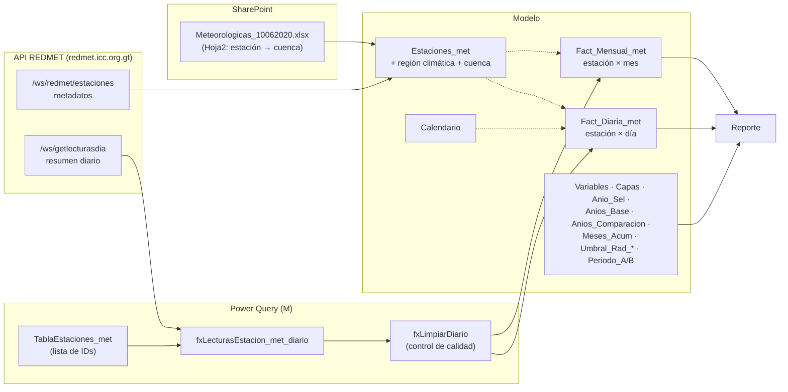

# Arquitectura del modelo

## Flujo de datos

Las dos tablas de hechos llaman a la API **por estación** (una llamada por cada ID de `TablaEstaciones_met`), aplican el mismo control de calidad y filtran por `RangeStart`/`RangeEnd` para la **actualización incremental**.

## Tablas de hechos

| Tabla | Grano | Origen | Historia | Uso |
|---|---|---|---|---|
| `Fact_Diaria_met` | estación × día | endpoint diario | 19 años, se refrescan los últimos 7 días | Series diarias, pentadas, mapas, periodos A/B, sensación térmica de los últimos días. |
| `Fact_Mensual_met` | estación × mes | endpoint diario agregado en Power Query (como `mensual_por_estacion()` de los scripts R) | 19 años, se refrescan los últimos 2 meses | Comparativos históricos, comparativas mensuales, acumulados. Incluye `N_Dias`, `Completitud`, `Mes_Completo` y `Mes_Valido`. |

`Fact_Mensual_met` no tiene relación con `Calendario`: las medidas filtran año y mes con `TREATAS`, para poder calcular el histórico de cualquier mes sin que el segmentador de año lo impida.

## Dimensiones y tablas auxiliares

| Tabla | Rol |
|---|---|
| `Estaciones_met` | Estaciones (código, nombre, país, estrato altitudinal de la API, región climática, cuenca, coordenadas). Filtra a las dos tablas de hechos. |
| `TablaEstaciones_met` | Lista fija de IDs que se descargan. **Aquí se agregan o quitan estaciones.** |
| `Cuencas_met` | Estación → cuenca desde el Excel de SharePoint; se une por nombre normalizado. |
| `Calendario` | Tabla de fechas marcada (2008 → 31-dic del año en curso), con jerarquía Año → Trimestre → Mes → Día, pentada, día juliano, año hidrológico y fechas en texto (`Fecha_Larga`, `Fecha_Abrev`). |
| `Variables` | Una fila por variable: unidad, regla de agregación, colores (de los scripts R), umbrales de anomalía. Las páginas la filtran y el segmentador "Variable" elige una. |
| `Capas` | Banderas de las gráficas tipo R: año actual, media histórica, rangos, años adicionales, anomalías. |
| `Anio_Sel` | Año de análisis (segmentador de selección única, orden descendente). |
| `Anios_Base` | Periodo histórico (segmentador de rango; solo ofrece años anteriores al de análisis). |
| `Anios_Comparacion` | Años adicionales (hasta 4) en las gráficas tipo R. |
| `Meses_Acum` | Eje de los acumulados en año calendario (ene–dic) o hidrológico (nov–oct). |
| `Umbral_Rad_Sub`, `Umbral_Rad_Opt` | Parámetros deslizables de los niveles de radiación. |
| `Periodo_A`, `Periodo_B`, `Dias_Periodo` | Comparación entre dos periodos. |
| `_Medidas` | Todas las medidas, en carpetas (ver `03_catalogo_medidas.md`). |

## Región climática y estrato

- **Estrato altitudinal:** viene de la API (litoral, bajo, medio, alto).
- **Región climática:** spatial join de las coordenadas de cada estación con `otros_archivos/regiones_gcs_wgs_1984.shp` (`tools/generar_regiones.R` → `config/estaciones_region.csv` → `tools/aplicar_regiones.py`, que la copia al bloque `<regiones>` de `Estaciones_met`). En El Salvador, la región se toma del estrato (Litoral/Bajo → Pacífico, Medio/Alto → Montañosa), como en `script_nuevo.R`.

## Control de calidad (`fxLimpiarDiario`)

Antes de cualquier cálculo, los valores diarios fuera de rango se reemplazan por nulo:

| Variable | Rango aceptado |
|---|---|
| Temperatura media, mínima y máxima | −5 a 50 °C |
| Precipitación | 0 a 400 mm/día |
| ETo | 0 a 15 mm/día |
| Radiación (Σ W/m² de 96 lecturas) | 0 a 44 444 (≈ 40 MJ/m²·día) |
| Sensación térmica | −5 a 70 °C |

## Definiciones

| Concepto | Definición |
|---|---|
| Energía solar diaria (`Rad_MJ`) | Σ lecturas de 15 min (W/m²) × 900 s / 10⁶ (MJ/m²). |
| Irradiancia diurna media | Σ W/m² del día / 52 lecturas (06:00–18:59, ventana fija como en los scripts R). |
| Balance hídrico | P − ETo; nulo si falta la ETo. |
| Mes válido | Mes terminado (antes de hoy, hora de Guatemala) con ≥ 80 % de días con dato. Los meses en curso no se muestran. |
| Temperatura máxima / mínima mensual | Extremo absoluto del mes en cada estación (decisión de los scripts R). |

## Reglas de agregación entre estaciones

| Variables | Regla |
|---|---|
| Acumulativas (precipitación, ETo, balance, radiación) | Suma por estación en el periodo y luego **promedio** de las estaciones con dato. |
| Promedios (temperatura media, ETo media diaria, irradiancia, sensación térmica media) | Promedio por estación y luego entre estaciones. |
| Extremos (temperatura y sensación térmica máximas/mínimas) | Extremo por estación y luego promedio entre estaciones. |

La selección puede ser toda la red (por defecto), una región o estrato (filtros) o estaciones elegidas: todas usan el mismo cálculo sobre el *pool* estación-mes.

## Histórico

Para cada mes: media, mínimo, máximo y percentiles 33 y 66 (`PERCENTILEX.INC`, igual a `quantile` tipo 7 de R) de los valores mensuales de la selección en los años del periodo histórico. El periodo nunca incluye el año de análisis. Los acumulados históricos son la suma acumulada de cada estadístico mensual, como en los scripts R.

## Gráficas tipo R (Deneb)

Los comparativos históricos usan el visual **Deneb** con especificaciones Vega-Lite (copias en `deneb/`). Cada visual recibe una tabla mes a mes con el valor actual, los estadísticos históricos, los años adicionales, los colores, títulos y banderas; la especificación dibuja las capas (rangos, media, años adicionales, año actual, anomalías) según esas banderas. Los nombres de los campos del visual (`valor`, `h_media`, `titulo`…) deben mantenerse: la especificación los usa.
