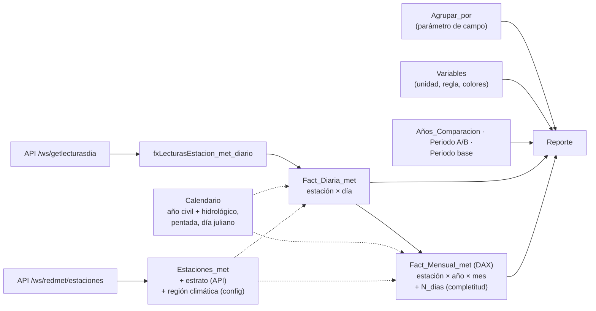

# Plan de reformulación — Tablero de condiciones observadas

> Estado: **borrador para aprobación** (2026-11-04). Marcar cada tarea al completarla y registrar el detalle en [02 · Decisiones y cambios](02_decisiones_y_cambios.md).

## Objetivo

Reconstruir el tablero con una arquitectura nueva que:

1. **Muestre la información meteorológica observada** (uso principal) y permita compararla con el histórico (apoyo a decisiones).
2. Conserve **todas las acciones** del tablero heredado (ver tabla de paridad).
3. Permita **agrupar de forma dinámica** por *estación*, *estrato altitudinal* o *región climática* **para todas las variables**.
4. Tenga la **apariencia de los gráficos de los scripts R** (`otros_archivos/`), y produzca los **mismos números** que esos scripts.
5. Reutilice lo probado en `Tablero-semanal-ICC` (funciones de API, calendario, dimensión de estaciones, actualización incremental, documentación).

## Diagnóstico de la versión heredada (resumen)

| Área | Problema | Consecuencia |
|---|---|---|
| Consultas | 60 tablas, una por estación (mismo M copiado), unidas en `Anexar1` con 57 pasos | Agregar una estación exige editar dos lugares; actualización lenta |
| Fechas | ~60 `LocalDateTable` automáticas; medidas dependen de `[Días].[NroMes]` | Modelo pesado; no hay calendario común |
| Pasos residuales | Columnas `Rad Min/Med/Max` constantes, `Nombre = "Cengicaña"`, `Día - Copia`, filtros `each true`, nombres con espacio final | Ruido y errores de mantenimiento |
| Radiación | `suma / 97 × 0.0864` | Subestima ~1 % (son 96 lecturas); peor con datos faltantes |
| Dimensiones | `Cuencas` y `Cuencas_real` desde Excel de 2020 en SharePoint, relación bidireccional; consultas sin uso | Datos desactualizados, ambigüedad de filtros |
| Medidas | ~50 medidas copiadas por variable × estadístico | Difícil de mantener |
| Históricos | "PROMEDIO" es la mediana; percentiles de valores **diarios** comparados con medias **mensuales** (Tmax, Tmin, Rad, ETPd, sensación térmica) | Banda normal demasiado ancha: el año actual casi siempre luce "normal" |
| Índice de calor | Columna calculada con Tmax + HRmax | Físicamente inconsistente; la API ya trae `indicecalormax` |
| Reporte | 19 páginas (4 ocultas), varias duplicadas | Navegación confusa |

## Arquitectura propuesta

### Tablas

| Tabla | Origen | Notas |
|---|---|---|
| `Estaciones_met` | API (igual que el semanal) | Se le une `config/estaciones_region.csv` (estación → región climática). El Salvador: región = estrato recodificado (Litoral/Bajo → Pacífico; Medio/Alto → Montañosa), como en `script_nuevo.R`. |
| `TablaEstaciones_met` | Lista de IDs | Único lugar para agregar o quitar estaciones (equivale a `estaciones_ids` y `estaciones_nousar` de R). |
| `Calendario` | M (del semanal) | Se agregan Pentada, Día juliano, Mes abreviado (Ene…Dic). |
| `Fact_Diaria_met` | `fxLecturasEstacion_met_diario` (del semanal) | Actualización incremental. Radiación en MJ/m² = suma W/m² × 900 / 10⁶. |
| `Fact_Mensual_met` | Tabla calculada DAX | Grano estación × año × mes: sumas (Pp, Rad, ETo), medias (T, HR, viento), `BH = Pp − ETo`, `N_dias`. Replica `mensual_por_estacion()` de R. |
| `Agrupar_por` | Parámetro de campo | Estación · Estrato altitudinal · Región climática. Se usa en ejes, leyendas y múltiplos pequeños. |
| `Variables` | Tabla (`config/variables.csv`) | Variable, unidad, regla de agregación, decimales y colores de los scripts R (ver Apariencia). |
| `Años_Comparacion` | Tabla desconectada | Equivale a `anios_ad` de R (líneas de años adicionales). |
| `Periodo A`, `Periodo B` | Copias de fechas | Conserva la comparación entre periodos. |
| `_Medidas` | — | Todas las medidas. |

### Reglas de cálculo (iguales a los scripts R)

1. **Lectura → día → mes por estación:** sumas para Pp, Rad, ETo; medias para T, HR, viento.
2. **Mes por grupo:** promedio de las estaciones del grupo (estrato, región o una sola estación) que tienen dato.
3. **Histórico por grupo y mes:** sobre los años del **periodo base** (por defecto, todos los anteriores al año de análisis): media, mínimo, máximo, P33 y P66 **de los valores mensuales del grupo** (no de valores diarios).
4. **Acumulados:** suma acumulada desde enero (o desde el inicio del año hidrológico, según se decida). Las bandas acumuladas se calculan como en R (`cumsum` de cada estadístico).
5. **Anomalías:** T en °C; Pp en mm y %. Categorías de `script_nuevo.R`: ±0.5/±1 °C y ±15/±40 %.
6. **Completitud:** un mes entra al histórico solo si tiene ≥ 80 % de días con dato (*mejora respecto a R; validar*).

Todas las medidas usan la variable elegida en `Variables` y la agrupación elegida en `Agrupar_por`, así que **un mismo visual sirve para todas las variables y agrupaciones**.

### Apariencia (de `tema_boletin` y las paletas de R)

| Elemento | Estilo |
|---|---|
| Rango histórico (mín–máx) | Banda clara (alfa ~0.18) |
| Rango normal (P33–P66) | Banda más intensa (alfa ~0.40) |
| Media histórica | Línea discontinua dorada (`gold1`/`gold3`) con puntos |
| Año de análisis | Línea continua gruesa con puntos, color por variable |
| Años adicionales | Paleta `#4000D3 #F720F0 #FF8C00 #666666 #008B8B #8B0000 #2F4F4F #B8860B`, etiqueta al final |
| Paletas por variable | T: `tomato`/`tomato3` + `red4` · Pp: `steelblue`/`steelblue4` + `blue4` · Rad: `#F4A460`/`#CD853F` + `#8B4513` · ETo: `#8FBC8F`/`#2E8B57` + `#006400` · BH: `#7EC8E3`/`#4A90D9`, barras `#2171B5` (superávit) / `#D94701` (déficit) |
| Anomalías | `#d73027 #fc8d59 #91bfdb #4575b4 #313695` (muy por encima → muy por debajo) |
| Tipografía y ejes | Fondo blanco, cuadrícula gris discontinua, ejes negros, título centrado en negrita, subtítulo gris, leyenda abajo, nota de fuente y n.º de años |

Se implementa con un **tema JSON** y, para el gráfico climatológico, con el visual que se decida (ver decisión D1).

## Paridad: páginas heredadas → páginas nuevas

| Página nueva | Reemplaza a (heredadas) |
|---|---|
| **1. Mapa y resumen** — valor del último día/semana/mes y anomalía por estación, coloreado por categoría | Mapa de precipitación, Mapa de Radiación, Mapa de Sensación Térmica |
| **2. Serie diaria** — variable × agrupación × rango de fechas, con tabla | Precipitación diaria, Comparativas por estación/por año (gráficas diarias), Comparación de Temperaturas |
| **3. Climatología mensual** — estilo R con bandas, media, actual, años adicionales y etiquetas de anomalía | Comparativo histórico de Pp, ETP (mensual y diaria), TMax, TMin, Radiación, Sensación térmica; Precipitación histórico (oculta) |
| **4. Acumulados** — Pp, Rad y ETo acumuladas vs. histórico; comparación Periodo A vs. B | Comparativas por estación, Comparativas por año (acumulada anual), Comparación entre Periodos (×2) |
| **5. Balance hídrico** — mensual (barras superávit/déficit + bandas) y por pentada | Balance hídrico (×2) |
| **6. Radiación por niveles** — pentadas con umbrales subóptimo/aceptable/óptimo editables | Comparación de Radiación |
| **7. Anomalías** — tabla/heatmap grupo × mes (como `script_nuevo.R`) | *Nuevo* |
| **8. Notas metodológicas** | *Nuevo* |

Panel de filtros uniforme en todas: Variable · Agrupar por · País · Estrato · Región · Estación · Año de análisis · Años adicionales.

## Fases

### Fase 0 · Línea base y seguridad
- [ ] Repositorio Git; commit 1 = versión heredada sin cambios.
- [ ] Commit 2 = README, plan, bitácora, `.gitignore`.
- [ ] Sacar las credenciales de los scripts R (`Sys.getenv("REDMET_USER")`/`.Renviron`) y cambiar esas contraseñas; luego versionar los scripts.

### Fase 1 · Definiciones y configuración
- [ ] Resolver las decisiones pendientes (abajo).
- [ ] `config/estaciones_region.csv` con `tools/generar_regiones.R` (spatial join con `regiones_gcs_wgs_1984.shp`, mismo criterio que R).
- [ ] `config/variables.csv` (variables, unidades, reglas, colores).

### Fase 2 · Modelo nuevo (rama `v2`)
- [ ] Nuevo proyecto `Condiciones_observadas.pbip` en este repositorio, con tablas tomadas del semanal (`Estaciones_met`, `TablaEstaciones_met`, `Calendario`, `fxLecturasEstacion_met_diario`, `Fact_Diaria_met`).
- [ ] `Fact_Mensual_met`, `Agrupar_por`, `Variables`, `Años_Comparacion`, `Periodo A/B`.
- [ ] Fecha/hora automática **desactivada**.

### Fase 3 · Medidas y validación
- [ ] Medidas genéricas: valor del periodo, histórico (media, mín, máx, P33, P66), acumulados, anomalías, categoría, colores dinámicos.
- [ ] **Validación contra R:** mismas cifras que `script_figs_zonasclima_.R` para 2 regiones × (Pp, T, Rad, ETo, BH) en un año cerrado (tolerancia 0.1).

### Fase 4 · Reporte y tema
- [ ] Tema JSON con el estilo de `tema_boletin`.
- [ ] Páginas 1–8 según la tabla de paridad.

### Fase 5 · Cierre
- [ ] Revisión de paridad página por página.
- [ ] Documentación (arquitectura, diccionario, medidas, guía de usuario) con los generadores del semanal.
- [ ] Publicación; retiro del `.pbip` heredado (queda en el historial de Git); etiqueta `v1.0`.

## Decisiones pendientes

| # | Tema | Opciones | Recomendación |
|---|---|---|---|
| D1 | Visual del gráfico climatológico | a) **Deneb** (Vega-Lite, visual certificado): reproduce ggplot casi exacto (dos bandas, media, actual, años con etiqueta, anomalías). b) Visuales nativos (línea con bandas de error): más simple, pero sin años adicionales con etiqueta al final ni dos bandas + leyenda por año en el mismo visual | **a) Deneb** para páginas 3–5; nativos en el resto |
| D2 | Tmax/Tmin mensual | a) promedio de máximas/mínimas diarias (climatológico estándar) · b) máxima/mínima absoluta del mes (como `script_nuevo.R`) | a), con b) como variable aparte |
| D3 | Inicio del año para acumulados | Enero (como R) · año hidrológico (como el semanal) · seleccionable | Seleccionable, enero por defecto |
| D4 | Estaciones | Las 44 de `script_nuevo.R` (GT + SV) · las ~60 del heredado (incluye Petén y otras) | Confirmar lista |
| D5 | Periodo base | Todos los años anteriores · ventana fija (p. ej. 2008–2025) · seleccionable | Seleccionable, todos por defecto |
| D6 | Cuencas | Se descartan (Excel de 2020) · se actualizan e incorporan a `Estaciones_met` | Confirmar si se siguen usando |
